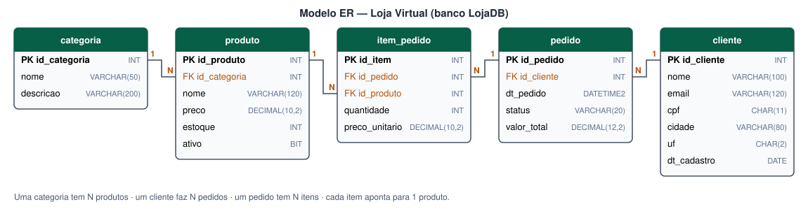

# Dados da Loja Virtual

Mesmo cenário do Trabalho 2: um banco **SQL Server** (`LojaDB`, em Docker) com **5 tabelas**,
populado por `scripts/gerar_dados.py` (biblioteca Faker, semente fixa).



| Tabela | Registros | Descrição |
|---|---:|---|
| `categoria` | 8 | Departamentos da loja |
| `cliente` | 1.015 | Clientes (inclui 15 cadastros duplicados) |
| `produto` | 200 | Produtos, 25 por categoria |
| `pedido` | 3.000 | Pedidos, com status e valor total |
| `item_pedido` | 8.971 | Itens de cada pedido |

## Problemas de qualidade (propositais)

Sistemas reais têm dados "sujos". Para a camada **silver** ter o que corrigir, o script insere 11
tipos de problema na origem:

| Código | Tabela | Problema | Exemplo |
|---|---|---|---|
| P01 | cliente | Nome com espaços sobrando / tudo minúsculo ou maiúsculo | `"  maria souza  "` |
| P02 | cliente | E-mail em maiúsculas e com espaços | `" ANA@GMAIL.COM "` |
| P03 | cliente | CPF com máscara | `147.209.358-50` |
| P04 | cliente | UF em minúsculas | `sc` |
| P05 | cliente | Cidade vazia | `NULL` |
| P06 | cliente | Cadastro duplicado (mesmo CPF, código novo) | 15 clientes |
| P07 | produto | Preço negativo (erro de sinal) | `-1108.59` |
| P08 | produto | Estoque negativo | `-7` |
| P09 | pedido | Status escrito de formas diferentes | `entregue`, `Pago`, `" ENVIADO "` |
| P10 | item_pedido | Quantidade zero | `0` |
| P11 | categoria | Descrição vazia | `NULL` |

## Extração (notebooks locais)

1. `00_setup_sqlserver` cria o banco e carrega `data/origem/*.csv`.
2. `01_extracao_sqlserver_para_landing` descobre **todas** as tabelas pelo `INFORMATION_SCHEMA`,
   grava cada uma em `data/landing/<tabela>.csv` e envia para o volume
   `/Volumes/workspace/landing/dados` com o **Databricks SDK** (`files.upload`).

```python
w = WorkspaceClient(host=DATABRICKS_HOST, token=DATABRICKS_TOKEN)
garantir_volume_landing(w)                       # cria schema landing + volume dados se faltar
w.files.upload(f"/Volumes/workspace/landing/dados/{tabela}.csv", conteudo, overwrite=True)
```
