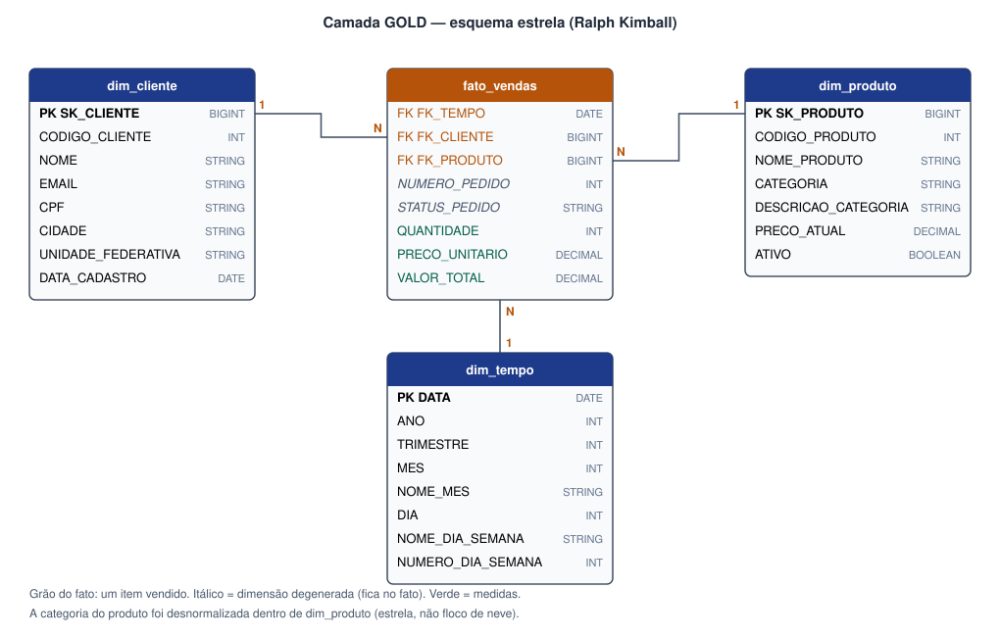

# Gold: modelo dimensional — `004_gold`

A gold organiza os dados num **esquema estrela** (Ralph Kimball): uma tabela **fato** com as medidas
do negócio cercada por **dimensões** com o contexto (quem, o quê, quando).



| Tabela | Tipo | Grão | Registros |
|---|---|---|---:|
| `dim_cliente` | Dimensão | Um cliente | 1.000 |
| `dim_produto` | Dimensão | Um produto, **com a categoria desnormalizada** | 200 |
| `dim_tempo` | Dimensão | Um dia (2024-01-01 a 2026-12-31) | 1.096 |
| `fato_vendas` | Fato | **Um item vendido** | 8.946 |

## Decisões de modelagem

- **Grão do fato = item do pedido**: é o nível mais detalhado; permite somar por produto, categoria,
  cliente, estado, dia, mês…
- **Chaves substitutas (`SK_`)** geradas pelo Delta: `BIGINT GENERATED BY DEFAULT AS IDENTITY` (igual
  ao notebook da aula). O fato liga-se às dimensões pela SK, não pelo código do sistema de origem.
- **Categoria dentro de `dim_produto`**: em vez de uma `dim_categoria` separada (floco de neve), a
  categoria foi *desnormalizada* — consultas mais simples e rápidas.
- **Dimensões degeneradas**: `NUMERO_PEDIDO` e `STATUS_PEDIDO` ficam no próprio fato (não teriam
  outros atributos).
- **Carga com MERGE (SCD Tipo 1)**: atualiza quem mudou e insere quem é novo, como na aula.

```sql
CREATE TABLE gold.dim_cliente (
    SK_CLIENTE          BIGINT GENERATED BY DEFAULT AS IDENTITY,
    CODIGO_CLIENTE      INT,
    NOME                STRING,
    EMAIL               STRING,
    CPF                 STRING,
    CIDADE              STRING,
    UNIDADE_FEDERATIVA  STRING,
    DATA_CADASTRO       DATE
) USING DELTA;

MERGE INTO gold.dim_cliente AS d
USING (SELECT CODIGO_CLIENTE, NOME, EMAIL, CPF, CIDADE, UNIDADE_FEDERATIVA, DATA_CADASTRO FROM cliente) AS s
ON d.CODIGO_CLIENTE = s.CODIGO_CLIENTE
WHEN MATCHED AND (d.NOME <> s.NOME OR d.EMAIL <> s.EMAIL OR ...) THEN UPDATE SET ...
WHEN NOT MATCHED THEN INSERT (...) VALUES (...);
```

```sql
INSERT INTO gold.fato_vendas
SELECT dt.DATA, dc.SK_CLIENTE, dp.SK_PRODUTO, p.CODIGO_PEDIDO, p.STATUS,
       i.QUANTIDADE, i.PRECO_UNITARIO, i.QUANTIDADE * i.PRECO_UNITARIO
FROM item_pedido i
JOIN pedido p           ON p.CODIGO_PEDIDO   = i.CODIGO_PEDIDO
JOIN gold.dim_cliente dc ON dc.CODIGO_CLIENTE = p.CODIGO_CLIENTE
JOIN gold.dim_produto dp ON dp.CODIGO_PRODUTO = i.CODIGO_PRODUTO
JOIN gold.dim_tempo dt   ON dt.DATA           = to_date(p.DATA_PEDIDO);
```

## Consultas de negócio

**Faturamento por categoria em 2024** (sem pedidos cancelados):

| Categoria | Faturamento (R$) | Itens |
|---|---:|---:|
| Informática | 1.518.748,46 | 778 |
| Eletrônicos | 645.637,45 | 792 |
| Esporte e Lazer | 525.246,40 | 724 |
| Casa e Cozinha | 354.204,40 | 715 |
| Beleza e Saúde | 225.207,57 | 783 |
| Brinquedos | 176.206,79 | 734 |
| Moda | 144.089,89 | 709 |
| Livros | 81.193,53 | 750 |

**Top 5 estados por faturamento:** GO, RR, SE, AM e PI.

!!! note
    Valores obtidos na simulação local dos notebooks (`uv run task simular`); no Databricks os
    números são os mesmos, pois os dados de origem são gerados com semente fixa.
