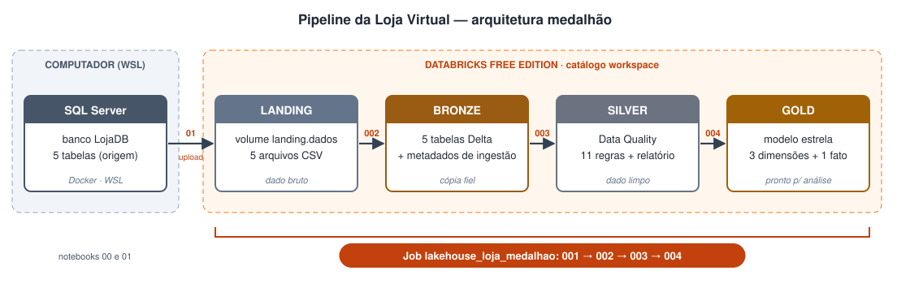

# Lakehouse com Databricks e arquitetura medalhão

!!! info "Trabalho 3 — Engenharia de Dados"
    - **Curso:** Engenharia de Software — SATC
    - **Professor:** Jorge Luiz da Silva
    - **Equipe:** Murilo Mandelli e Augusto Benedetti

## Objetivo

Construir um **pipeline de dados no Databricks Free Edition** (experiência **PaaS**) implementando a
**arquitetura medalhão** — *Landing → Bronze → Silver → Gold* — com todas as etapas encadeadas por
uma **Job**.

É o complemento dos trabalhos anteriores:

| | Trabalho 1 | Trabalho 2 | **Trabalho 3** |
|---|---|---|---|
| Onde roda | Spark local | Spark local + Docker | **Databricks (nuvem, PaaS)** |
| Origem | CSV | SQL Server | SQL Server |
| Camadas | — | landing → bronze | **landing → bronze → silver → gold** |
| Tratamento | — | — | **Data Quality** na silver |
| Modelo final | — | — | **Dimensional (Kimball)** na gold |
| Orquestração | manual | manual | **Job (Jobs & Pipelines)** |

O cenário é o mesmo do Trabalho 2: uma **loja virtual** com 5 tabelas (categoria, cliente, produto,
pedido e item_pedido).

## O pipeline

| Etapa do enunciado | Onde está |
|---|---|
| 1. Extrair todas as tabelas de um banco para CSV em `LANDING/DADOS` | Notebooks locais `00` e `01` |
| 2. Ler os CSV da landing e gravar em Delta na `BRONZE` | `002_bronze` |
| 3. Ler a bronze, aplicar **Data Quality** e gravar na `SILVER` | `003_silver` |
| 4. Ler a silver e alimentar as tabelas **dimensionais** na `GOLD` | `004_gold` |
| 5. Encadear tudo numa **Job** | Job `lakehouse_loja_medalhao` (001 → 002 → 003 → 004) |

!!! question "Por que a extração roda fora do Databricks?"
    O Databricks Free Edition roda na nuvem e não enxerga um banco que está no nosso computador
    (`localhost`). A extração é feita localmente e os arquivos são enviados ao volume da landing —
    o mesmo papel de uma ferramenta de ingestão. Daí em diante, tudo roda no Databricks.

!!! tip "README x MkDocs"
    O **README** do repositório explica **como instalar e executar**. Este site explica **o que** foi
    feito, **por quê** e **quais foram os resultados**.
