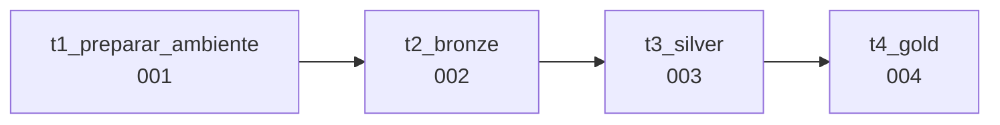

# Job: encadeamento das etapas

O enunciado pede que todas as execuções estejam encadeadas por uma **Job** (*Jobs & Pipelines*), com
cada etapa executada **em sequência**.



| Tarefa | Notebook | Depende de | O que garante |
|---|---|---|---|
| `t1_preparar_ambiente` | `001_preparar_ambiente` | — | Schemas e volume existem (`IF NOT EXISTS`) |
| `t2_bronze` | `002_bronze` | t1 | Só roda com o ambiente pronto |
| `t3_silver` | `003_silver` | t2 | Só limpa depois que a bronze foi atualizada |
| `t4_gold` | `004_gold` | t3 | Só monta o modelo dimensional com a silver pronta |

Se uma tarefa falhar, as seguintes **não executam** — a gold nunca é montada com dados
incompletos.

## Como criar no Databricks

1. **Jobs & Pipelines ▸ Create ▸ Job**, nome `lakehouse_loja_medalhao`.
2. Primeira tarefa: *Task name* `t1_preparar_ambiente`, *Type* **Notebook**, *Source* **Workspace**,
   *Path* `.../notebooks/databricks/001_preparar_ambiente`, *Compute* **Serverless**.
3. **+ Add task ▸ Notebook** para `002_bronze`, com *Depends on* = `t1_preparar_ambiente`.
4. Repita para `003_silver` (depende de `t2_bronze`) e `004_gold` (depende de `t3_silver`).
5. **Run now** e acompanhe o grafo em **Runs**.

A definição completa está versionada em `jobs/job_lakehouse_loja.json`:

```json
{
  "name": "lakehouse_loja_medalhao",
  "tasks": [
    { "task_key": "t1_preparar_ambiente", "notebook_task": { "notebook_path": ".../001_preparar_ambiente" } },
    { "task_key": "t2_bronze", "depends_on": [{ "task_key": "t1_preparar_ambiente" }], "notebook_task": { "notebook_path": ".../002_bronze" } },
    { "task_key": "t3_silver", "depends_on": [{ "task_key": "t2_bronze" }], "notebook_task": { "notebook_path": ".../003_silver" } },
    { "task_key": "t4_gold",   "depends_on": [{ "task_key": "t3_silver" }], "notebook_task": { "notebook_path": ".../004_gold" } }
  ]
}
```

!!! note "Por que a extração não está na Job?"
    A extração lê um banco no nosso computador, que o Databricks (na nuvem) não acessa. Ela roda
    antes, no WSL, e deixa os CSV no volume da landing. A Job começa a partir daí.
