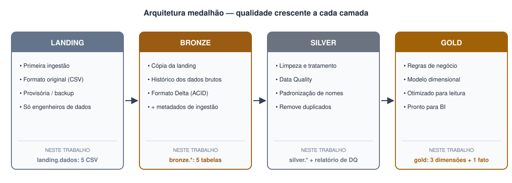

# Arquitetura medalhão

A **arquitetura medalhão** é um padrão para organizar os dados de um *lakehouse* em camadas que
melhoram a **estrutura e a qualidade** dos dados progressivamente (também chamada de *multi-hop*).

| Camada | Formato | Características | Neste trabalho |
|---|---|---|---|
| **Landing** | Original (CSV, JSON…) | Primeira ingestão; provisória; serve de backup para recriar os dados | Volume `workspace.landing.dados` com 5 CSV |
| **Bronze** | Delta | Cópia da landing; dados brutos imutáveis; histórico; metadados de ingestão | `bronze.*` + `data_hora_bronze`, `nome_arquivo` |
| **Silver** | Delta | Limpeza, padronização, remoção de duplicados, tratamento de nulos (**Data Quality**) | `silver.*` + relatório com 11 regras |
| **Gold** | Delta | Regras de negócio; modelo otimizado para leitura (**dimensional**/OBT) | Esquema estrela: 3 dimensões + 1 fato |



## Os objetos no Databricks

O Databricks Free Edition usa o **Unity Catalog**, que organiza tudo em três níveis:
**catálogo → schema → tabela/volume**.

| Objeto | Nome | O que é |
|---|---|---|
| Catálogo | `workspace` | Catálogo padrão do Free Edition |
| Schema | `landing`, `bronze`, `silver`, `gold` | Um "banco" por camada |
| Volume | `landing.dados` | Pasta gerenciada para arquivos (`/Volumes/workspace/landing/dados`) |
| Tabelas | `bronze.cliente`, `gold.fato_vendas`… | Tabelas Delta **gerenciadas** (`saveAsTable`) |

```sql
CREATE SCHEMA IF NOT EXISTS workspace.landing;
CREATE VOLUME IF NOT EXISTS workspace.landing.dados;
CREATE SCHEMA IF NOT EXISTS workspace.bronze;
CREATE SCHEMA IF NOT EXISTS workspace.silver;
CREATE SCHEMA IF NOT EXISTS workspace.gold;
```

!!! note "Tabelas gerenciadas"
    Como no material da aula, as tabelas são criadas com `saveAsTable` — são **gerenciadas
    (MANAGED)**: o Unity Catalog cuida dos arquivos e dos metadados. `DESCRIBE EXTENDED` mostra
    `Type: MANAGED`. (A diferença para tabelas externas foi discutida no Trabalho 2.)

## PaaS

O Databricks é uma **plataforma como serviço**: não instalamos Spark, Java nem cluster. Escrevemos
os notebooks e a plataforma fornece o processamento (**serverless**), o armazenamento, o catálogo e
o orquestrador de Jobs.
